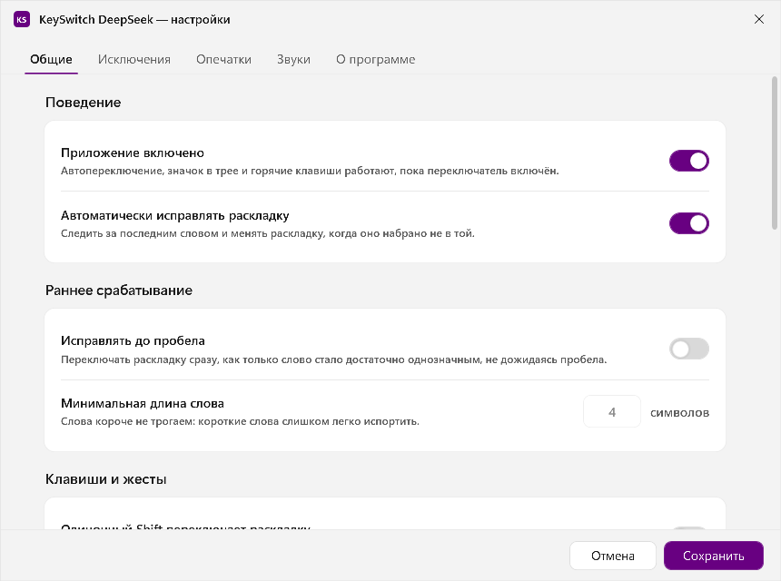
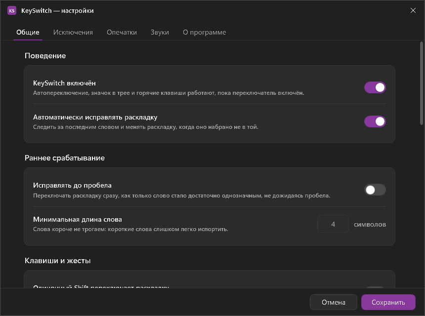
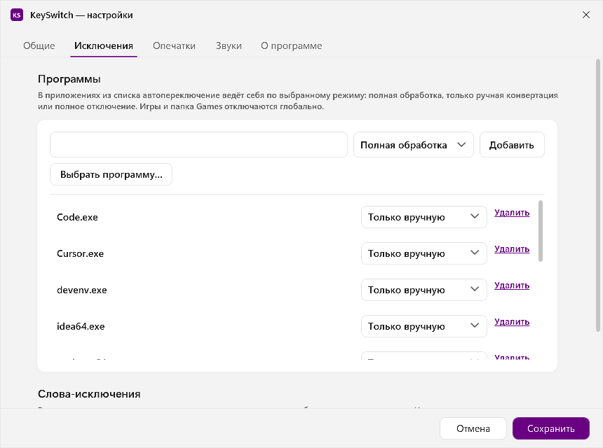
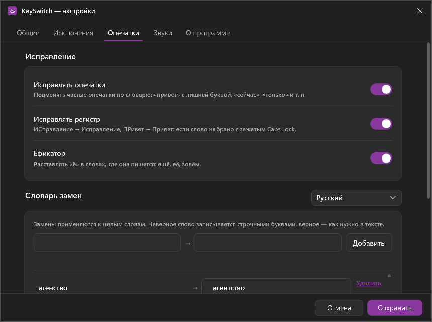
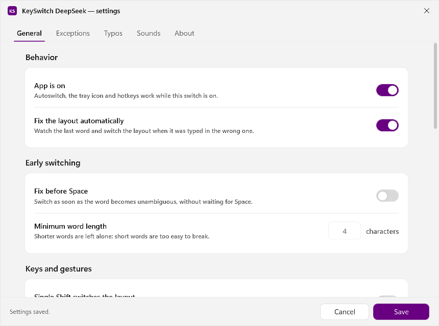
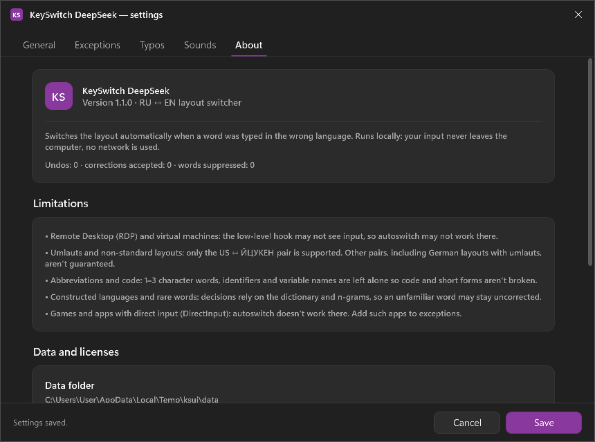

<div align="center">

# KeySwitch DeepSeek

**Automatic keyboard layout switcher for Windows 11.**
Typed `руддщ` — got `hello`. No internet, no telemetry, no cloud.

[](#installation)
[](#building-from-source)
[](#accuracy)
[](#privacy)
[](LICENSE)

[Download](#installation) · [Features](#features) · [How it works](#how-it-works) · [Limitations](#limitations-honest) · [Development](#building-from-source)

🇷🇺 [Русская версия](README.md)

</div>



KeySwitch DeepSeek watches what you type and notices a word typed in the wrong layout.
`руддщ` becomes `hello`, `ghbdtn` becomes `привет`: the word is erased, the window
layout is switched, and the word is typed again. Every decision is made on your
own machine in a few milliseconds.

The app lives in the tray as an `RU` / `EN` icon. There is no main window.

## Features

| | |
|---|---|
| **Auto-switch** | At a word boundary (space, Enter, Tab) it detects the layout mistake and fixes it: `Backspace` × N → window layout switch → word and space in one `SendInput`. |
| **Manual conversion** | `Pause/Break` converts the last word, `Ctrl+Shift+Space` converts the selected text (hotkey is configurable; `Alt+Shift` is never used — Windows owns it). |
| **Undo** | Double `Shift` (two taps faster than 400 ms) or `Pause/Break` restores the original text and layout. |
| **Force conversion** | If autoswitch left a word alone (unknown word, code, abbreviation), a double `Shift` converts the last word to the other layout on demand. |
| **Self-learning** | A word you undo three times stops being converted. Only the word and a counter are stored — no context, no windows, no typing history. |
| **Exceptions** | Apps with modes "disabled / manual only / full", game folders, individual words with a direction. |
| **Games and passwords** | Fullscreen games pause switching (browsers do not), password fields and password-looking strings are never touched. |
| **Typos** | Auto-fix of common mistakes (`тоесть` → `то есть`, `teh` → `the`), rules live in an editable file. |
| **"ИСправление"** | `ПРивет` → `Привет`: two capitals at the start of a word. |
| **Yo-fixer** | Adds `ё` only where the dictionary is unambiguous. |
| **Sounds** | Optional WAV cues on switch and on typo fix, with volume control. |
| **Bilingual UI** | The settings window and tray menu switch language on the fly, no restart. Defaults to the Windows language. |

Everything except auto-switching is off by default: the app starts working without
any setup and stays out of the way until you ask for more.

The interface is available in **Russian and English** — Settings → General → Interface language
(or "Same as system"). The language switches instantly, no restart needed.

## Screenshots

| Light theme | Dark theme |
|---|---|
|  |  |
|  |  |
|  |  |

## Installation

1. Download `KeySwitchDeepSeek.exe` from [Releases](../../releases/latest) and run it.
   No administrator rights needed, no .NET install needed — the build is self-contained.
2. The `RU` or `EN` icon appears in the tray.
3. Right click → **Settings**; enable **Start with Windows** if you want.

Requirements: Windows 11 x64. Windows 10 1809+ works but is not tested.

## How it works

1. A low-level keyboard hook (`WH_KEYBOARD_LL`) copies each keystroke into a queue and returns
   in 1–3 ms. Everything heavy — layout resolution, UI Automation, the detector, `SendInput` —
   happens on a worker thread.
2. The word buffer collects the current word. Letters are resolved from the layout of the
   **focused thread** (`GetGUIThreadInfo` → `GetKeyboardLayout`), which is what actually types
   the characters in Chrome, Electron and WinUI 3 apps.
3. At the word boundary the detector scores two readings: as typed, and converted through the
   physical key table into the other layout. A dictionary hit, character 3/4-gram models and
   "impossible combinations" rules decide. If the word as typed is a real dictionary word,
   it is never touched.
4. On a confident decision the app erases the word plus the space, switches the window layout
   (`WM_INPUTLANGCHANGEREQUEST`), and retypes the word and the space in one `SendInput` call,
   marked with its own `dwExtraInfo` so the hook ignores it. Chrome and Electron get a 12 ms
   pause between erase and retype.

Typical correction time measured on a live system: **25–31 ms** from space to finished word.

## Accuracy

| Metric | Result |
|---|---|
| Unit tests | 376 passed |
| RU words, typed in EN layout | 99.64 % switched correctly (553/555) |
| RU words, typed in RU layout (reverse) | 99.64 % |
| EN words, typed in RU layout | 100.00 % (820/820) |
| False switches on correct words | 0.00 % |
| Detector speed | 7.5–9.3 µs per word |

The two remaining RU misses are words missing from the 400 000-word dictionary; they are left
as typed, which is the safe direction of the error.

## Settings

- **General** — on/off, auto-switch, early switch, single-Shift layout toggle, double-Shift undo,
  confidence threshold, start with Windows, run as administrator, safe mode, theme, interface language.
- **Exceptions** — processes (by exe name and by folder) with three modes, word list with direction.
- **Typos** — editable RU/EN replacement rules, caps fix, yo-fixer.
- **Sounds** — switch and fix sounds, volume.
- **About** — version, data licenses, limitations.

Settings, exceptions, learning counters and logs live in `%APPDATA%\KeySwitchDeepSeek\`.

## Limitations (honest)

- **Memory**: about 110 MB at idle, ~190 MB after the settings window was opened once (WPF loads
  Direct3D and does not give it back). The target was 80 MB; the reason and the measurements are
  in `DECISIONS.md` (D023). If you need it lower, the settings UI can be moved out of the idle path.
- **Elevated windows**: without administrator rights the hook cannot see keystrokes in elevated
  apps (UIPI). The tray shows a warning; the "run as administrator" option registers a scheduled task.
- **RDP and virtual machines**: layout switching inside a remote session is unreliable.
- **Umlauts and non-RU/EN layouts**: only US English and Russian (ЙЦУКЕН) are modelled.
- **Lowercase abbreviations and code**: `cfg`, `id`, `x` look like words in both layouts; the
  detector leaves them alone, but code editors should be added to exceptions.
- **Artificial languages**: identifiers in code are not words in either dictionary.
- Two RU words out of 555 in the corpus are not switched (see Accuracy).

## Privacy

- No network activity at all: no telemetry, no update checks, no analytics.
- Keystrokes are never written to disk. The log contains technical events only — no typed text.
- Self-learning stores only the word and a counter. There is no typing history, no context,
  no screenshots, no clipboard archive.

## Building from source

```powershell
dotnet build KeySwitch.sln -c Release      # build
dotnet test src\KeySwitch.Tests -c Release # 376 tests
.\publish.ps1                              # build + test + publish to artifacts\publish
```

`publish.ps1` produces a self-contained single-file `artifacts\publish\KeySwitchDeepSeek.exe`.
The installer script is `installer\KeySwitchDeepSeek.iss` (Inno Setup 6.3+, per-user install).

## Repository structure

| Path | Purpose |
|---|---|
| `src/KeySwitch.Core` | Word buffer, layout tables, detector, correction engine, post-processors |
| `src/KeySwitch.Data` | Dictionaries, n-gram models, settings, exceptions, learning, logs |
| `src/KeySwitch.Hooks` | Keyboard hook, `SendInput`, layout switching, UI Automation, clipboard |
| `src/KeySwitch.App` | Tray, orchestration, WPF settings window, localization |
| `src/KeySwitch.Tests` | 376 xUnit tests |
| `tools/Evaluate` | Corpus runner: accuracy and false-positive metrics |
| `tools/BuildAssets` | Asset generator (dictionaries, n-grams, yo pairs, typo rules) |
| `tools/probe` | Live end-to-end stand (Notepad / Chrome) |

## Documentation

- [ARCHITECTURE.md](ARCHITECTURE.md) — layers, flows, on-disk data, extensibility
- [DECISIONS.md](DECISIONS.md) — 30 engineering decisions with rationale
- [DEVLOG.md](DEVLOG.md) — stage-by-stage development log with measurements
- [docs/CONTRACTS.md](docs/CONTRACTS.md) — layer API contracts

## Data licenses

| Asset | Source | License |
|---|---|---|
| RU/EN word lists | LibreOffice dictionaries (Hunspell `ru_RU`, `en_US`) | LGPL 2.1 / MPL 1.1 |
| Frequency lists | hermitdave/FrequencyWords | MIT |
| Character n-grams | Tatoeba sentences | CC BY 2.0 FR |

The program code is MIT (see [LICENSE](LICENSE)); the dictionaries keep their own licenses.

## Search terms

Keyboard layout switcher for Windows 11 · automatic layout correction · RU EN layout fix ·
typed in wrong layout · ghbdtn → привет · руддщ → hello · переключатель раскладки Windows 11 ·
автокоррекция раскладки · keyboard layout auto switch · offline typo fixer · tray app C# .NET 8
