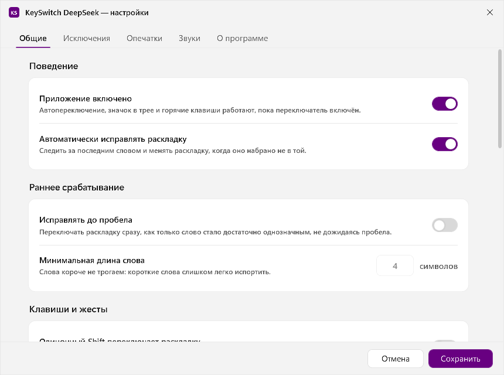
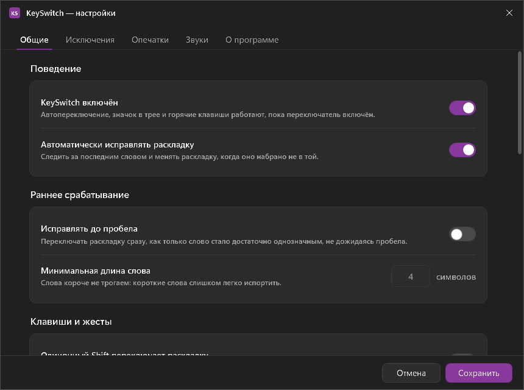
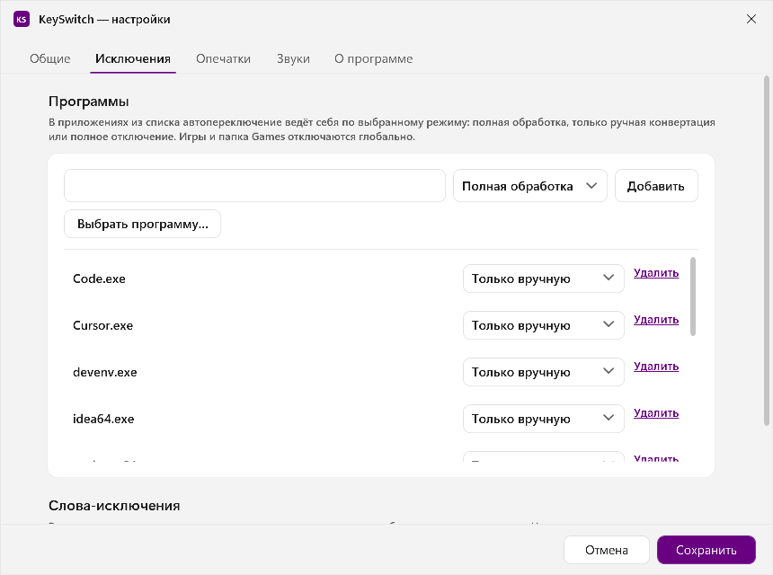
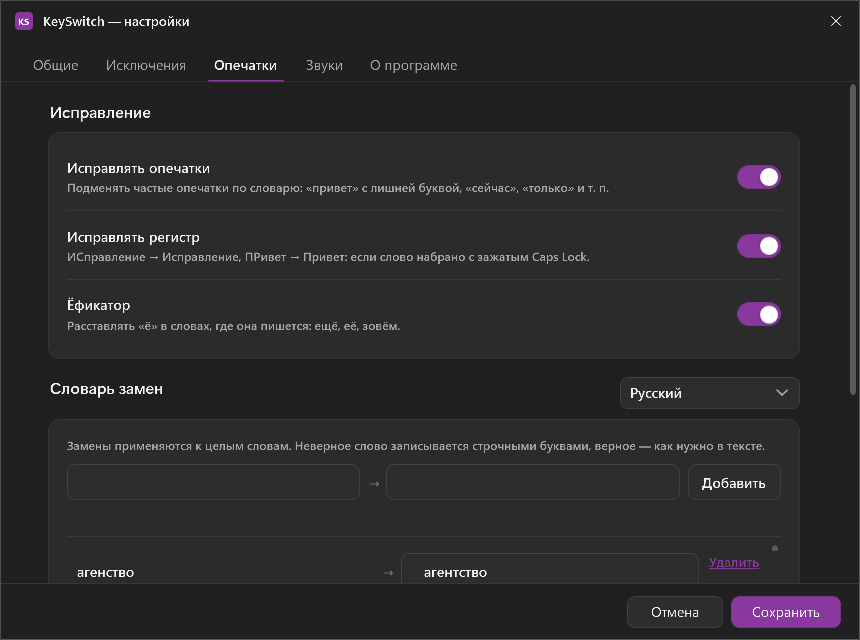
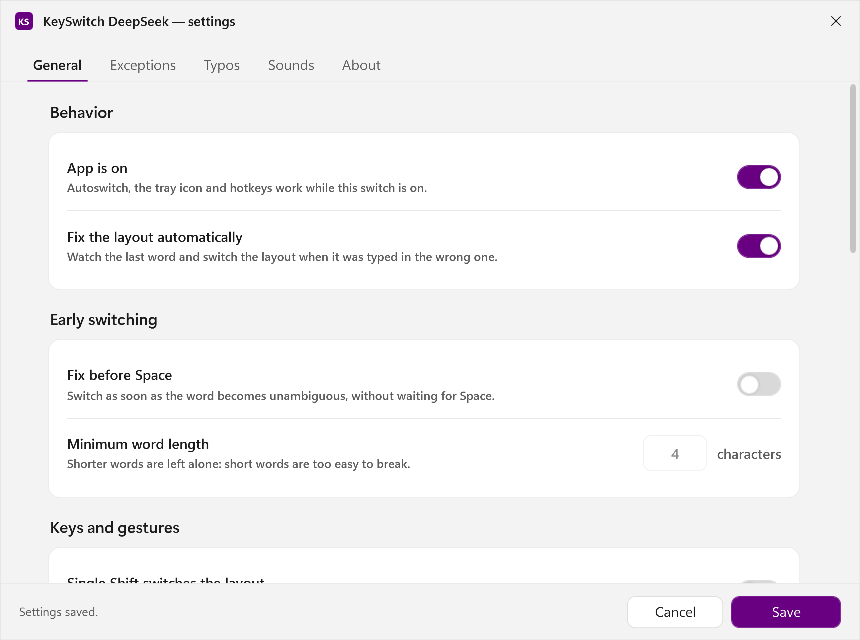
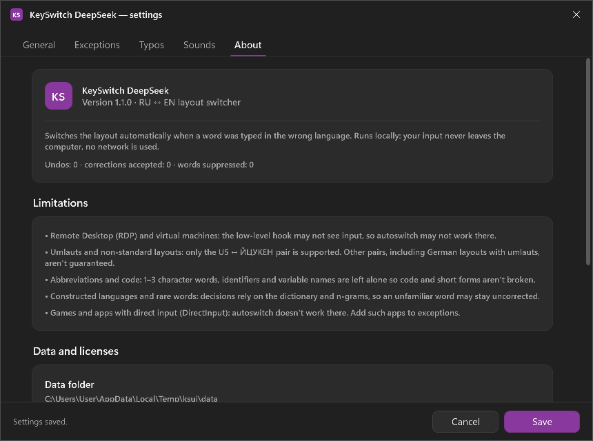

<div align="center">

# KeySwitch DeepSeek

**Автоматический переключатель раскладки клавиатуры для Windows 11.**
Набрали `ghbdtn` — получили `привет`. Без интернета, без телеметрии, без облака.

[](#установка)
[](#сборка-из-исходников)
[](#точность)
[](#приватность)
[](LICENSE)

[Скачать](#установка) · [Возможности](#возможности) · [Как работает](#как-это-работает) · [Ограничения](#ограничения-честно) · [Разработка](#сборка-из-исходников)

🇬🇧 [English version](README.en.md)

</div>



KeySwitch DeepSeek следит за тем, что вы печатаете, и замечает слово, набранное не в той
раскладке. Вместо `руддщ` в чате появляется `hello`, вместо `ghbdtn` — `привет`:
слово стирается, раскладка окна переключается, слово печатается заново.
Всё решение принимается на вашем компьютере за единицы миллисекунд.

Программа живёт в трее иконкой `RU` / `EN`, главного окна нет.

## Возможности

| | |
|---|---|
| **Автопереключение** | На границе слова (пробел, Enter, Tab) определяет ошибку раскладки и исправляет её: `Backspace` × N → смена раскладки окна → слово и пробел одним `SendInput`. |
| **Ручная конвертация** | `Pause/Break` — последнее слово, `Ctrl+Shift+Space` — выделенный текст (сочетание настраивается; `Alt+Shift` не используется, он занят Windows). |
| **Отмена** | Двойной `Shift` (два тапа быстрее 400 мс) или `Pause/Break` возвращают исходный текст и раскладку. |
| **Одиночные буквы** | Одна буква в чужой раскладке тоже исправляется: `привет малыш b карлсон` → `привет малыш и карлсон`. Конвертируется только в однобуквенное слово (`и`, `в`, `с`, `к`, `о`, `у`, `я`), поэтому одиночные `a` и `i` остаются как набраны. |
| **Принудительная конвертация** | Если автопереключение слово не тронуло (незнакомое слово, код, аббревиатура) — двойной `Shift` переводит последнее слово в другую раскладку вручную. |
| **Самообучение** | Отменённое трижды слово перестаёт конвертироваться. Хранятся только слово и счётчик — без контекста, окон и истории. |
| **Исключения** | Программы с режимами «выключено / только ручная конвертация / полностью», папки с играми, отдельные слова с направлением. |
| **Игры и пароли** | Игры отключают переключение по трём признакам: полный экран (браузеры — нет), папки Steam/Epic/GOG/Battle.net/Games, окна движков Unity/Unreal/SDL/GLFW. Галочка в настройках, по умолчанию включена. Поля паролей и «похожие на пароль» строки не трогаются. |
| **Опечатки** | Автоисправление частых ошибок (`тоесть` → `то есть`, `teh` → `the`), правила в редактируемом файле. |
| **«ИСправление»** | `ПРивет` → `Привет`: две заглавные в начале слова. |
| **Ёфикатор** | Ставит `ё` только в однозначных случаях по словарю. |
| **Звуки** | Необязательные WAV-сигналы на переключение и исправление, регулировка громкости. |
| **Интерфейс RU/EN** | Язык окна настроек и меню трея переключается на лету, без перезапуска. По умолчанию — язык Windows. |
| **Проверка обновлений** | Пункт «Проверить обновления…» в трее и кнопка на вкладке «О программе»: один запрос к GitHub только по нажатию. |

Всё, кроме автопереключения, по умолчанию выключено — программа начинает работать
без настройки и не мешает, пока вы сами не попросите большего.

## Скриншоты

| Светлая тема | Тёмная тема |
|---|---|
|  |  |
|  |  |
|  |  |

## Установка

1. Скачайте `KeySwitchDeepSeek-1.2.4-setup.exe` из [раздела Releases](../../releases/latest)
   и запустите. Прав администратора не нужно: программа ставится в
   `%LOCALAPPDATA%\Programs\KeySwitchDeepSeek`, добавляет ярлык в меню «Пуск», запись
   «Удаление программ» и штатный деинсталлятор. .NET устанавливать не требуется — сборка
   self-contained.
2. Иконка `RU` или `EN` появится в трее.
3. Правый клик → **Настройки**; при желании включите **Запускать при входе**.

Требования: Windows 11 x64. Windows 10 1809+ работает, но не тестируется.

Если установщик не нужен, в том же релизе лежит портативный `KeySwitchDeepSeek.exe` —
он работает из любой папки без установки.

## Как это работает

1. **Хук.** Глобальный `WH_KEYBOARD_LL` копирует нажатие (виртуальный код, скан-код,
   Shift/CapsLock) в очередь и сразу возвращается — 1–3 мс, тяжёлой работы в колбэке нет.
2. **Слово.** Рабочий поток собирает буфер текущего слова. Границы — пробел, Enter, Tab;
   буфер сбрасывается при смене окна, клике мышью, `Ctrl`/`Alt`-комбинациях, стрелках,
   `Home`/`End`. Символ берётся из раскладки **потока фокуса** — иначе в Chrome, Notepad
   и Electron-приложениях слово собиралось бы не из той раскладки.
3. **Детектор.** Строятся два прочтения: «как набрано» (A) и «в другой раскладке» (B).
   Сравниваются по словарю (400 000 русских и 98 000 английских словоформ), символьным
   3–4-граммам и правилам невозможных сочетаний. Если A есть в словаре — слово не
   трогается никогда; переключение происходит, только когда B правдоподобно, а A нет.
4. **Исправление.** `Backspace` × (длина + 1), `WM_INPUTLANGCHANGEREQUEST` активному окну,
   слово и пробел одним `SendInput` с `KEYEVENTF_UNICODE`. В браузерах и Electron между
   стиранием и вводом пауза 12 мс. Свои события помечены `dwExtraInfo` и хуком игнорируются.

Подробности — в [ARCHITECTURE.md](ARCHITECTURE.md), причины решений — в
[DECISIONS.md](DECISIONS.md).

## Настройки

Правый клик по иконке → **Настройки**. Вкладки: **Общие** (автопереключение, раннее
срабатывание, одиночный `Shift`, порог уверенности, автозапуск, режим администратора,
тема, горячие клавиши), **Исключения** (программы, папки, слова), **Опечатки**,
**Звуки**, **О программе** (версия, лицензии, ограничения, папка данных).

Настройки — обычные JSON-файлы в `%APPDATA%\KeySwitchDeepSeek\`: их можно читать и править
любым редактором.

## Ограничения (честно)

- **Окна с правами администратора.** Без повышенных прав Windows не отдаёт нажатия из
  таких окон (UIPI). Включите «Запускать от администратора» — программа сама перезапустится
  с запросом UAC и создаст задачу в планировщике, которая будет запускать её с правами при
  входе в систему. Когда активно привилегированное окно, а приложение работает без прав,
  в трее появляется предупреждение.
- **RDP и виртуальные машины.** Хук может не видеть ввод, а смена раскладки — не
  применяться; такие сеансы лучше добавить в исключения.
- **Умляуты и другие раскладки.** Поддерживается пара US ↔ ЙЦУКЕН; остальные
  конвертируются только вручную.
- **Аббревиатуры и код.** Слова из 1–3 символов и «слова» вида `xq`, `id`, `if` не
  трогаются: точность важнее охвата. Искусственные языки (код, транслит) не распознаются.
- **Старые игры на DirectInput** не принимают Unicode-ввод — их стоит добавить в исключения.
- **Память.** В простое ~108 МБ, после первого открытия окна настроек ~190 МБ: WPF
  поднимает Direct3D-стек и держит его до выхода. Цель «≤ 80 МБ» не достигнута — что уже
  сделано и почему остаток не убирается, описано в [DECISIONS.md](DECISIONS.md), D023.
  Сборка self-contained без сжатия бандла весит ~144 МБ (со сжатием — 67 МБ, но рабочий
  набор вырастает до ~280 МБ).

## Приватность

- В фоне нет сетевой активности: единственный запрос — проверка обновлений, и только
  по нажатию пользователя (GET последнего релиза на GitHub, без идентификаторов и телеметрии).
- Текст набора никогда не пишется на диск. В журнале — только технические события:
  процесс, длина слова, раскладка, решение и его причина.
- Обучение хранит только слово и счётчики отмен/принятий.
- Поля паролей (UI Automation `IsPassword`) и строки, похожие на пароль, не обрабатываются.
- Безопасный режим отключает перехват клавиатуры полностью.

## Точность

Измерено `tools/Evaluate` на корпусах RU/EN в обеих раскладках (Windows 11 26100, .NET 8):

| Критерий | Цель | Факт |
|---|---|---|
| Юнит-тесты | — | 467 пройдено, 0 пропущено |
| Верных переключений RU, прямое / обратное | ≥ 98 % | 99,64 % / 99,64 % (553/555) |
| Верных переключений EN | ≥ 98 % | 100,00 % (820/820) |
| Ложные срабатывания на корректных словах | ≤ 0,5 % | 0,00 % |
| Решение детектора | — | 7,5–9,3 мкс на слово |
| «Терминатор → исправление» | ≤ 100 мс | 25–31 мс на живой проверке (Notepad, Chrome) |
| Колбэк хука | — | 1–3 мс, предупреждение в журнале при ≥ 20 мс |
| CPU в простое | ≈ 0 % | 0 % |
| Память в простое | ≤ 80 МБ | **108 МБ** — не достигнуто, см. D023 |

## Сборка из исходников

```powershell
dotnet build KeySwitch.sln -c Release
dotnet test src/KeySwitch.Tests -c Release
dotnet run --project tools/Evaluate -c Release -- --corpus tools/Evaluate/corpus-sample.txt --lang ru --layout en
```

Публикация одним файлом:

```powershell
.\publish.ps1              # сборка + тесты + publish в artifacts\publish
```

Установщик собирается из `installer/KeySwitchDeepSeek.iss` (Inno Setup 6.3+, установка per-user):

```powershell
& "$env:LOCALAPPDATA\Programs\Inno Setup 6\ISCC.exe" /DMyAppVersion=1.2.4 installer\KeySwitchDeepSeek.iss
```

Результат — `artifacts\installer\KeySwitchDeepSeek-1.2.4-setup.exe` (~49 МБ, lzma2).

Словари и n-граммы уже встроены в `KeySwitch.Data`; пересобрать их из открытых
источников можно так:

```powershell
dotnet run --project tools/BuildAssets -- --out src/KeySwitch.Data/Assets
```

## Структура репозитория

```
src/KeySwitch.Core     буфер слова, таблицы раскладок, детектор, движок исправлений
src/KeySwitch.Data     словари, n-граммы, настройки, исключения, обучение, журнал
src/KeySwitch.Hooks    хук WH_KEYBOARD_LL, SendInput, раскладки, UI Automation, трей-натив
src/KeySwitch.App      трей, автозапуск, оркестрация, окна WPF, установщик
src/KeySwitch.Tests    xUnit: раскладки, границы слов, детектор, отмена, исключения
tools/Evaluate         консольный стенд точности на корпусах
tools/BuildAssets      сборка словарей и n-грамм из открытых источников
tools/probe            живой стенд: реальное окно + реальный KeySwitch DeepSeek + журнал
```

## Документация

[ARCHITECTURE.md](ARCHITECTURE.md) — слои, потоки, данные на диске ·
[DECISIONS.md](DECISIONS.md) — все решения и их причины ·
[DEVLOG.md](DEVLOG.md) — журнал разработки по этапам ·
[docs/CONTRACTS.md](docs/CONTRACTS.md) — контракты слоёв.

## Лицензии данных

Код — MIT. Словари и корпуса — открытые, с собственными лицензиями; тексты лежат в
`src/KeySwitch.Data/Assets/licenses/`, сводка — [DECISIONS.md](DECISIONS.md), D018.

## Поисковые запросы

переключатель раскладки, автопереключатель раскладки Windows 11, исправление раскладки,
печатаю не в той раскладке, ghbdtn привет, русская раскладка английская раскладка,
keyboard layout switcher Windows, automatic keyboard layout switch, RU EN layout fix,
typo correction Windows, tray keyboard utility, offline keyboard tool.
